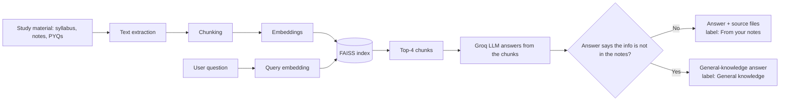

# Semester Study Assistant

**A RAG-based study assistant that answers from your own syllabus, notes and PYQs first, and tells you when it had to fall back to general knowledge.**


---

## Overview

Semester Study Assistant is an end-to-end Retrieval-Augmented Generation (RAG) application built for a BTech CSE (AI & Data Science) semester. A student asks a question; the app searches the semester material using semantic search, passes the most relevant chunks to an LLM, and shows the answer together with the source files it used.

If the notes do not contain the answer, the app falls back to the LLM's general knowledge and **labels the answer as such**, so the student always knows whether an answer came from their material.

**Subjects covered:** Computer Networks · DBMS · Discrete Mathematics · DSA · Data Science & Visualization

## Problem Statement

Course material is spread across syllabus PDFs, lecture notes and previous-year question papers. Finding the answer to a specific question means searching through several files manually, and general-purpose chatbots answer from memory with no link to what was actually taught in the course.

## Solution

The assistant builds a searchable index over the course material and answers questions in three steps: **retrieve** relevant chunks, **generate** an answer from those chunks, and **show sources**. A fallback path handles questions the notes cannot answer, and the UI makes the origin of every answer explicit.

## What This Project Demonstrates

| Skill | Where it appears |
|---|---|
| Document processing | `src/document_loader.py` |
| Chunking | `src/chunking.py` |
| Semantic embeddings | `src/embeddings.py` (`all-MiniLM-L6-v2`) |
| Vector search | `src/vector_store.py` (FAISS) |
| Retrieval + LLM generation | `src/rag_pipeline.py` (top-k = 4, Groq) |
| Fallback handling | Notes-first, general-knowledge fallback with source labels |
| Evaluation | `src/evaluate.py` (retrieval), `src/evaluate_answers.py` (LLM judge) |
| Application layer | `app/app.py` (Streamlit) |

## Key Features

- Semantic search over syllabus, notes and PYQs across five subjects
- Top-4 chunk retrieval with FAISS similarity search
- LLM answers generated from retrieved context (Groq, `openai/gpt-oss-20b`)
- Source files displayed with every answer
- Clear origin label in the UI:
  - **From your notes**: answer built from retrieved chunks
  - **General knowledge (not found in your notes)**: fallback answer
- Sidebar listing the covered subjects
- API key read from `.env`, with an input-box fallback in the UI
- Two evaluation scripts: retrieval quality and generated-answer quality

## How It Works



1. Study documents are loaded and processed into text.
2. The text is divided into chunks.
3. Each chunk is converted into an embedding with `all-MiniLM-L6-v2`.
4. Embeddings are indexed with FAISS; chunks are stored alongside in a pickle file.
5. The user enters a question in the Streamlit UI.
6. The question is embedded with the same model.
7. FAISS retrieves the 4 most similar chunks (`top_k = 4`).
8. The chunks are passed to the LLM as context.
9. The LLM generates an answer from that context.
10. The UI displays the answer and its source files.
11. If the notes-based answer indicates the information is unavailable, the app falls back to general LLM knowledge and labels it accordingly.

## Tech Stack

| Layer | Technology |
|---|---|
| Language | Python |
| UI | Streamlit |
| Embeddings | Sentence Transformers, `all-MiniLM-L6-v2` |
| Vector search | FAISS |
| LLM inference | Groq API, `openai/gpt-oss-20b` |
| Numerics / storage | NumPy, Pickle |
| Configuration | python-dotenv |
| Version control | Git / GitHub |

## Project Structure

```
semester-study-assistant/
├── app/
│   └── app.py                 # Streamlit application
├── src/
│   ├── __init__.py
│   ├── document_loader.py     # load and extract text from study material
│   ├── chunking.py            # split documents into chunks
│   ├── embeddings.py          # embedding model
│   ├── vector_store.py        # FAISS index build and search
│   ├── rag_pipeline.py        # retrieval, generation, fallback
│   ├── evaluate.py            # retrieval evaluation (subject-level Recall@4)
│   ├── evaluate_answers.py    # answer evaluation (LLM judge)
│   └── check_models.py        # check available Groq models
├── processed_data/
│   ├── chunks.pkl             # chunked text + metadata
│   ├── embeddings.npy         # chunk embeddings
│   └── faiss_index.index      # FAISS index
├── data/                      # subject-wise material (e.g. Descrete_Mathematics/)
├── .env                       # local secrets (not committed)
├── .gitignore
└── requirements.txt
```

> The Discrete Mathematics folder is spelled `Descrete_Mathematics` in the dataset; the spelling is kept as-is to match the code.

## Installation

```bash
git clone https://github.com/madhushankarkr-cmd/semester-study-assistant.git
cd semester-study-assistant

python -m venv .venv

# Windows
.venv\Scripts\activate
# macOS / Linux
source .venv/bin/activate

pip install -r requirements.txt
```

## Environment Variables

Create a `.env` file in the project root:

```env
GROQ_API_KEY=your_actual_groq_api_key
GROQ_MODEL="openai/gpt-oss-20b"
```

| Variable | Purpose |
|---|---|
| `GROQ_API_KEY` | Your Groq API key (get one from the Groq console) |
| `GROQ_MODEL` | Groq model used for generation |

Never commit `.env`. It is listed in `.gitignore`.

## Running Locally

```bash
streamlit run app/app.py
```

The app needs the files in `processed_data/` (`chunks.pkl`, `embeddings.npy`, `faiss_index.index`). If they are missing, regenerate them from your own material in `data/` by running the preprocessing and indexing pipeline (`document_loader.py` → `chunking.py` → `embeddings.py` → `vector_store.py`).

## Evaluation

The project has two evaluation scripts that measure different things.

### 1. Retrieval evaluation: `src/evaluate.py`

Measures whether the retriever finds material from the correct subject.

- **Test set:** 25 questions across Computer Networks, DBMS, DSA, Discrete Mathematics and Data Science & Visualization
- **Metric:** subject-level Recall@4. A question counts as correct if the expected subject appears in any of the top 4 retrieved chunks.

### 2. Answer evaluation: `src/evaluate_answers.py`

Measures the quality of generated answers using an LLM as judge.

- **Test set:** 5 questions: CSMA/CD, primary key, normalization in DBMS, binary search, pigeonhole principle
- **Metrics:** correctness and relevance

## Evaluation Results

| Evaluation | Test set | Result |
|---|---|---|
| Retrieval, subject-level Recall@4 | 25 questions | **24/25 = 0.96** |
| Answer correctness (LLM judge) | 5 questions | **10/10 = 1.00** |
| Answer relevance (LLM judge) | 5 questions | **10/10 = 1.00** |

**Notes on these numbers**

- The 0.96 retrieval result was measured before one ambiguous question was fixed. The question "What is a relation?" could belong to both DBMS and Discrete Mathematics, so it was rewritten as "What is a relation between two sets in discrete mathematics?". The corrected set has not been re-run yet, so no improved figure is claimed.
- On the current 5-question answer evaluation set, the LLM judge scored generated answers 10/10 for correctness and 10/10 for relevance. This does **not** mean the answers were grounded in the notes: the normalization question was answered from the **general-knowledge fallback** (`Source: general`), not from retrieved chunks.

**Known weaknesses of the current evaluation**

- Subject-level Recall@4 is a lenient metric. Finding any chunk from the right subject is easier than finding the right chunk, so it will not catch a retriever that returns the right subject but the wrong passage.
- The answer set is small (5 questions) and the judge is an LLM, so results are an early signal, not a benchmark.
- There is no explicit faithfulness / groundedness metric yet, so the evaluation cannot tell whether an answer is supported by the retrieved context.

This is an early evaluation setup and is meant to be expanded (see Future Improvements).

## Deployment

The app is **not deployed yet**. Planned deployment target: Streamlit Community Cloud.

1. Push the project to GitHub.
2. Connect the repository in Streamlit Community Cloud.
3. Set the main file path to `app/app.py`.
4. Add the secrets in the app settings:
   ```toml
   GROQ_API_KEY = "your_actual_groq_api_key"
   GROQ_MODEL = "openai/gpt-oss-20b"
   ```
5. Deploy.

A live link will be added here once the app is deployed.

## Security and API Key Handling

- The Groq key is read from `GROQ_API_KEY` in a local `.env` file, or from deployment secrets.
- `.env` is excluded from version control and no key appears anywhere in the repository.
- If no key is found in the environment, the UI offers an input box so the key can be entered at runtime.
- If a key is ever committed by mistake, revoke it in the Groq console and create a new one.

## Limitations

- **Fallback is not notes-only RAG.** The app can answer from general LLM knowledge when the notes do not help, and those answers are not verified against the course material.
- **Fallback detection is phrase-based.** The pipeline checks the notes-based answer for phrases that signal missing information, which is simple but can misfire in either direction. In the answer evaluation, the normalization question fell back to general knowledge.
- **Evaluation is small and lenient** (see above); retrieval quality at the chunk level has not been measured.
- **Sources are shown as files**, not as page-level citations.
- Small knowledge base limited to one semester and five subjects.
- Embedding model is English-oriented; Hinglish queries may retrieve less accurately.
- Depends on the Groq API (free-tier rate limits apply) and internet access.

## Future Improvements

- [ ] Re-run retrieval evaluation after the question fix and report the new result
- [ ] Chunk-level Recall@k with expected file and page for each question
- [ ] Larger test set, including multi-unit, paraphrased and out-of-scope questions
- [ ] Faithfulness / groundedness metric for generated answers
- [ ] Similarity-threshold based fallback instead of phrase matching
- [ ] Page-level citations
- [ ] Hybrid search (BM25 + embeddings) and a reranker, compared with an ablation table
- [ ] Chunk-size experiments
- [ ] OCR support for scanned PDFs
- [ ] Deploy on Streamlit Community Cloud and add the live link

## Screenshots

| Home | Answer from notes | General-knowledge fallback |
|---|---|---|
| _Add screenshot_ | _Add screenshot_ | _Add screenshot_ |

<!-- Save images in docs/ and reference them like:  -->

## Contributing

Issues and suggestions are welcome. To contribute, fork the repository, create a branch, and open a pull request describing the change. Please do not commit API keys or copyrighted course material.

## License

A license file has not been added yet. Until one is added, all rights are reserved by the author.

## Author

**Madhu Shankar Kumar**  
BTech CSE | AI & Data Science, GLA University  
[GitHub](https://github.com/madhushankarkr-cmd) · [LinkedIn](https://www.linkedin.com/) <!-- replace with your profile link -->
