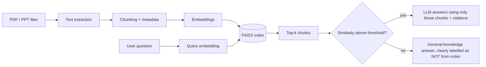

# Semester Study Assistant

A RAG (Retrieval-Augmented Generation) chatbot that answers questions about AI & Data Science course material, with **source citations** and an **"I don't know" mode** when the notes don't contain the answer.

**Live demo:** TODO_add_link_after_deploy  
> Free hosting: the first load can take 20-40 seconds (cold start).

 <!-- TODO: add a 20-30 sec screen recording -->

---

## Why I built this

Generic chatbots answer from memory and can sound confident while being wrong. I wanted an assistant that answers **from the course material first**, shows exactly where the answer came from, and says so when it can't find one. I built every component of the pipeline by hand (no LangChain) to understand how each part affects answer quality.

## Features

- [x] Ingests PDFs and PPTs, with subject/file/page metadata on every chunk
- [x] Semantic search (sentence-transformers + FAISS)
- [x] Answers with citations (subject, file, page)
- [x] Similarity-threshold based "not found in notes" handling
- [x] Streamlit chat UI
- [ ] Hybrid search (BM25 + embeddings) *(planned)*
- [ ] Reranker *(planned)*
- [ ] OCR for scanned PDFs *(planned)*

## How it works



## Design decisions

| Decision | Choice | Why |
|---|---|---|
| Chunk size / overlap | TODO (e.g. 800 / 100 characters) | Tested 300 / 600 / 1000, see results below |
| Embedding model | `all-MiniLM-L6-v2` | Small, fast, runs on CPU |
| Vector store | FAISS (metadata kept in a separate list) | Simple, no server needed |
| Top-k | TODO | Tuned on the evaluation set |
| Similarity threshold | TODO | Chosen so out-of-scope questions are rejected |
| LLM | Groq-hosted open model (TODO: exact model name) | Free tier, fast |

## Evaluation

- **Test set:** TODO (target 30-40) hand-written questions, each labelled with the correct source (file + page/unit). Includes harder cases: questions spanning two units, paraphrased questions, and out-of-scope questions.
- **Metric:** Recall@k = fraction of questions where the correct source chunk appears in the top-k retrieved chunks.

| Setup | Recall@4 |
|---|---|
| Chunk 300 | TODO |
| Chunk 600 | TODO |
| Chunk 1000 | TODO |
| Best config | TODO |

- **Out-of-scope handling:** TODO of TODO unrelated questions were correctly rejected.
- **Note:** the knowledge base is small (TODO documents), so numbers should be read in that context.

### Where it fails
TODO: 3-4 real failure cases you found (e.g. tables or formulas extracted badly, paraphrased questions missing the right chunk) and what you learned.

## Limitations

- Scanned / image-only PDFs are skipped (no OCR in v1)
- Fallback answers use the LLM's general knowledge, not live web search, and can be wrong
- Small knowledge base; retrieval quality on a much larger corpus is untested
- English-first embedding model; Hinglish queries may retrieve worse

## Project structure

```
semester-study-assistant/
├── app/app.py              # Streamlit UI
├── src/
│   ├── document_loader.py  # PDF / PPT text extraction
│   ├── chunking.py         # chunking + metadata
│   ├── embeddings.py       # embedding model wrapper
│   ├── vector_store.py     # FAISS index build / search
│   ├── rag_pipeline.py     # retrieval + prompt + LLM call
│   └── evaluate.py         # Recall@k evaluation
├── eval/questions.json     # hand-labelled test questions
├── data/                   # your course files (NOT committed)
├── requirements.txt
└── README.md
```

## Setup

```bash
git clone https://github.com/madhushankarkr-cmd/semester-study-assistant.git
cd semester-study-assistant
pip install -r requirements.txt

# add your own course files under data/<subject>/
python -m src.vector_store      # build the index
echo "GROQ_API_KEY=your_key" > .env
streamlit run app/app.py
```

Run the evaluation: `python -m src.evaluate`

## Adding a new subject

Create `data/<new_subject>/`, drop the files in, and rebuild the index. No code changes needed. *(Only keep this section if you have actually tested it.)*

## Data and privacy

Course notes, PYQs and any text derived from them are **not included** in this repository (they may be copyrighted). Add your own material under `data/`. API keys live in `.env` / Hugging Face secrets and are never committed.

## Author

**Madhu Shankar Kumar**: AI & Data Science, GLA University  
[GitHub](TODO) · [LinkedIn](TODO)
